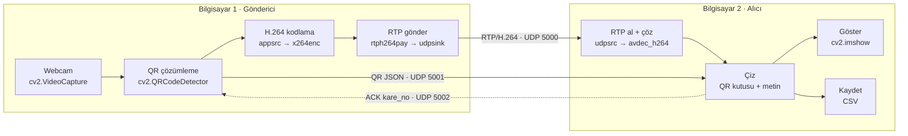

# QR Canlı Aktarım

Bir bilgisayardaki webcam görüntüsünü GStreamer (RTP/H.264) ile ikinci bilgisayara gerçek zamanlı aktaran, QR kodlarını göndericide çözüp sonucu ayrı bir UDP kanalıyla (JSON) gönderen sistem. İki bilgisayar arasındaki bağlantı Ubiquiti Rocket telsiz köprüsü üzerinden kurulur.

## Mimari



Paketler iki bilgisayar arasında Rocket telsiz köprüsünden geçer (bilgisayar → Ethernet → PoE → Rocket ⇄ Rocket → PoE → Ethernet → bilgisayar).

**Görüntü aktarımı: GStreamer, RTP + H.264**
- H.264, kareleri tek tek JPEG olarak göndermeye göre çok daha az bant genişliği kullanır. Bant genişliği sınırlı ve dalgalı olan telsiz bağlantıda bu belirleyicidir.
- RTP, UDP üzerinde çalışır ve kaybolan paketi beklemez. Böylece TCP'de olduğu gibi gecikme birikmez; görüntü hep güncel kalır.
- Gerçek İHA ve drone video sistemlerinde yaygın kullanılan bir yöntemdir.
- Telsiz bağlantı için ayarlar: RTP paketleri küçük tutulur (`--mtu 1200`), böylece parçalanma ve kayıp azalır. Anahtar kare sıklığı (`--key-int`) ve bitrate (`--bitrate`) bağlantı kalitesine göre değiştirilebilir.

**QR çözümleme: göndericide**
- QR, sıkıştırılmadan önceki ham ve net kareden okunur. H.264 sıkıştırması ya da paket kaybı görüntüyü bozsa bile sonuç etkilenmez.
- Sonuç çok küçük bir metin olduğu için görüntü kalitesi düşse de doğru şekilde ulaşır.
- Bu yapı, uçağın hedefi kendisi tespit edip yer istasyonunun izlediği İHA mantığına benzer.

**QR sonucunun iletimi: ayrı UDP kanalı (JSON)**
- RTP video kanalı yalnızca görüntü taşır. QR sonucu her karede ayrı bir UDP mesajıyla gönderilir:
  `{"kare_no": 152, "zaman": 1764240000.123, "qr_metinleri": ["..."], "koseler": [[[x,y],[x,y],[x,y],[x,y]]]}`
- QR yoksa boş liste gönderilir; böylece alıcı eski kutuyu siler.
- Bir mesaj kaybolsa bile bir sonraki karede yenisi gelir; beklemeye gerek yoktur.

**Karşıya ham kare gönderilir, çizimi alıcı yapar**
- Göndericide çizilen kutu ve yazı H.264 sıkıştırmasında bulanıklaşır.
- Alıcı çizdiğinde net görünür.

## Gereksinimler

- İki bilgisayar, gönderici tarafında webcam
- İki Ubiquiti Rocket modem, PoE adaptörleri ve Ethernet kabloları
- Test edilen sistemler:
  - Gönderici: Ubuntu 24.04, Python 3.12
  - Alıcı: Ubuntu ____, Python ____ (GStreamer 1.28.1)
- apt paketleri:

```bash
sudo apt install gstreamer1.0-tools gstreamer1.0-plugins-base gstreamer1.0-plugins-good \
  gstreamer1.0-plugins-bad gstreamer1.0-plugins-ugly gstreamer1.0-libav \
  python3-opencv python3-numpy v4l-utils
```

> **Önemli:** OpenCV'yi `pip install opencv-python` ile **kurmayın**. pip sürümü GStreamer desteği olmadan gelir; apt'taki `python3-opencv` desteklidir.

## Kurulum

```bash
git clone https://github.com/elifakkaya7/qr-canli-aktarim
cd qr-canli-aktarim
/usr/bin/python3 -m venv --system-site-packages .venv
source .venv/bin/activate
pip install -r requirements.txt
python -c "import cv2; print(cv2.getBuildInformation())" | grep -i gstreamer   # YES görünmeli
```

- `/usr/bin/python3` tam adresi, conda veya başka bir sanal ortam açık olsa bile ortamın sistem Python'una bağlanmasını sağlar.
- `--system-site-packages`, ortamın apt ile kurulan OpenCV'yi görmesini sağlar.
- Her yeni terminalde proje klasöründe `source .venv/bin/activate` çalıştırın.

## Ağ kurulumu (Rocket telsiz köprüsü)

1. **Kablolama:** Bilgisayar → Ethernet → PoE adaptörünün **LAN** girişi; PoE adaptörünün **POE** girişi → Rocket. İki tarafta da aynı.
2. **Wi-Fi'yi kapatın:** Açık kalırsa paketler telsiz köprü yerine Wi-Fi'den gidebilir.
3. **Sabit IP verin:** Ayarlar → Ağ → Kablolu → IPv4 → Elle:

| Bilgisayar | Adres | Ağ maskesi | Ağ geçidi |
| --- | --- | --- | --- |
| Gönderici | `192.168.1.101` | `255.255.255.0` | boş |
| Alıcı | `192.168.1.102` | `255.255.255.0` | boş |

4. **Bağlantıyı test edin:**

```bash
ping 192.168.1.101           # alıcıdan göndericiye (göndericiden: ping 192.168.1.102)
ip route get 192.168.1.101   # "dev enp..." gibi kablolu bir arayüz görünmeli, "wlp..." değil
```

5. **Güvenlik duvarı** açıksa (`sudo ufw status` → `active`), alıcıda: `sudo ufw allow 5000:5002/udp`

### Kullanılan portlar

| Port | Protokol | Yön | Ne taşır |
| --- | --- | --- | --- |
| 5000 | UDP | gönderici → alıcı | Video (RTP/H.264) |
| 5001 | UDP | gönderici → alıcı | QR sonucu (JSON) |
| 5002 | UDP | alıcı → gönderici | Gecikme ölçümü yanıtı (kare_no) |

Port numaraları, görüntü boyutu, bitrate ve JSON alan adları `common/config.py` dosyasındadır; iki program da ayarları buradan okur.

## Çalıştırma

### 1. Hızlı test (kod olmadan, sadece GStreamer)

Alıcı:

```bash
gst-launch-1.0 -v udpsrc port=5000 caps="application/x-rtp,media=video,encoding-name=H264,payload=96,clock-rate=90000" ! rtpjitterbuffer latency=0 ! rtph264depay ! avdec_h264 ! videoconvert ! autovideosink sync=false
```

Gönderici:

```bash
gst-launch-1.0 -v v4l2src device=/dev/video0 ! video/x-raw,width=640,height=480,framerate=30/1 ! videoconvert ! x264enc tune=zerolatency speed-preset=ultrafast bitrate=1500 key-int-max=30 ! rtph264pay config-interval=1 pt=96 ! udpsink host=192.168.1.102 port=5000
```

Alıcıda kamera görüntüsü açılıyorsa ağ ve GStreamer hazırdır. Programları çalıştırmadan önce iki komutu da `Ctrl+C` ile kapatın; açık kalırlarsa kamerayı ve portu tutarlar.

### 2. Programlar

Önce alıcı:

```bash
python3 receiver/receiver.py
```

Sonra gönderici:

```bash
python3 sender/sender.py --host 192.168.1.102 --show
```

Kameraya bir QR gösterin: alıcı ekranında QR'ın etrafında yeşil kutu ve metni görünür, terminalde `[QR] ...` satırı çıkar. Göndericinin terminali her saniye FPS, QR kanal gecikmesi ve kayıp yüzdesini yazar. Kapatmak için pencerede `q` ya da terminalde `Ctrl+C`.

### Gönderici seçenekleri

| Seçenek | Varsayılan | Ne işe yarar |
| --- | --- | --- |
| `--host` | (zorunlu) | Alıcının IP adresi |
| `--bitrate` | 1500 | H.264 hedef bitrate (kbit/s); bağlantı zayıfsa düşürün |
| `--key-int` | 30 | Kaç karede bir anahtar kare; kayıplı bağlantıda küçültün (ör. 15), görüntü kayıptan sonra daha çabuk düzelir |
| `--mtu` | 1200 | RTP paket boyutu (bayt) |
| `--qr-her` | 1 | QR'ı kaç karede bir oku; FPS düşerse 2–3 yapın |
| `--kamera` | 0 | Kamera numarası (`/dev/video0` → 0) |
| `--show` | kapalı | Göndericide de önizleme penceresi aç |

Örnek, zayıf bağlantı için: `python3 sender/sender.py --host 192.168.1.102 --bitrate 800 --key-int 15`

## Çıktılar

Her çalıştırma `logs/` altında adında tarih-saat olan ayrı dosyalar oluşturur.

| Dosya | Program | Sütunlar |
| --- | --- | --- |
| `qr_<tarih-saat>.csv` | alıcı | zaman, kare_no, qr_metni, gonderici_zamani (her QR yalnızca ilk göründüğünde ya da 2 sn görünmeyip geri geldiğinde yazılır) |
| `perf_alici_<tarih-saat>.csv` | alıcı | saniyede bir: zaman, fps, alinan_qr_mesaji, beklenen_qr_mesaji, kayip_yuzde |
| `perf_gonderici_<tarih-saat>.csv` | gönderici | saniyede bir: zaman, fps, qr_rtt_ort/min/max_ms, qr_gecikme_ms, gonderilen, onaylanan, kayip, kayip_yuzde, bitrate_kbps, key_int, mtu |

## Performans sonuçları

**Nasıl ölçüldü**
- **FPS:** İki programda da saniyede işlenen kare sayısı (`perf_*.csv`).
- **QR kanal gecikmesi:** Alıcı her JSON'un `kare_no`'sunu geri yollar; gönderici gidiş-dönüş süresini kendi saatiyle ölçüp ikiye böler (RTT/2). Tek saat kullanıldığı için bilgisayarların saatlerinin aynı olması gerekmez.
- **Uçtan uca (kamera-ekran) gecikme:** Kameraya milisaniye gösteren bir kronometre tutulup alıcı ekranıyla aynı fotoğrafta çekildi; iki değerin farkı alındı (5–10 fotoğrafın ortalaması).
- **Bant genişliği:** Alıcıda `nload` ile ölçüldü.
- **QR mesaj kaybı:** Gönderilen ve alınan `kare_no` sayılarının farkı (%).

| Deney | Mesafe | Bitrate (kbit/s) | key-int | Ort. FPS (alıcı) | Kamera-ekran gecikmesi (ms) | QR kanal gecikmesi (ms) | Bant (Mbit/s) | QR kayıp (%) | Görüntü bozulması |
| --- | --- | --- | --- | --- | --- | --- | --- | --- | --- |
| 1 | yakın | 1500 | 30 |  |  |  |  |  |  |
| 2 | yakın | 500 | 30 |  |  |  |  |  |  |
| 3 | yakın | 3000 | 30 |  |  |  |  |  |  |
| 4 | uzak | 1500 | 30 |  |  |  |  |  |  |
| 5 | uzak | 800 | 15 |  |  |  |  |  |  |

TODO: Ölçümler yapılınca tabloyu doldurun ve sonuçları 2–3 cümleyle yorumlayın.

## Sınırlamalar

- **Video ile QR mesajlarının eşleşmesi:** Video kareleri numarasız gider; QR sonucu ayrı kanaldan gelir. Alıcı her kareye en son gelen QR bilgisini çizer ve 0,5 saniyeden eski bilgiyi göstermez. QR'lar yavaş hareket ettiği için fark gözle zor görülür, ama birebir kare eşleşmesi değildir.
- **Gecikme ölçümü:** Video karelerinin numarası olmadığı için uçtan uca gecikme kronometre yöntemiyle ölçülür. QR kanalının gecikmesi ise gidiş-dönüş süresi (RTT/2) ile ölçülür.
- **Telsiz bağlantı:** Mesafe ve engellere göre bant genişliği düşebilir ve paket kaybı artabilir. Kayıp anında görüntüde bir sonraki anahtar kareye kadar bozulma görülebilir; QR sonucu bundan etkilenmez.
- **Kamera formatı:** Bazı webcamler 640×480@30 ham görüntü vermez (`not-negotiated` hatası). Desteklenen formatlar `v4l2-ctl --list-formats-ext` ile görülebilir.
- **Türkçe karakterler:** `cv2.putText` ş, ğ, İ gibi harfleri ekrana `?` olarak çizer. CSV ve terminal çıktısı doğrudur.

## Grup üyeleri

- Kişi A (gönderici): Elif Akkaya
- Kişi B (alıcı): İclal Öztürk