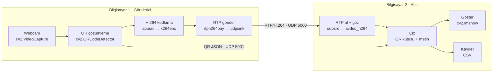

# QR Canlı Aktarım

Bir bilgisayardaki webcam görüntüsünü GStreamer (RTP/H.264) ile ikinci bilgisayara gerçek zamanlı aktaran, QR kodlarını göndericide çözüp sonucu ayrı bir UDP kanalıyla (JSON) gönderen sistem.

> Bu README geliştirme sırasında doldurulacaktır.

## Mimari



**Görüntü aktarımı: GStreamer, RTP + H.264**
- H.264, kareleri tek tek JPEG olarak göndermeye göre çok daha az bant genişliği kullanır. Bu, zayıf veya uzak bağlantılarda belirleyicidir.
- RTP, UDP üzerinde çalışır ve kaybolan paketi beklemez. Böylece TCP'de olduğu gibi gecikme birikmez; görüntü hep güncel kalır.
- Gerçek İHA ve drone video sistemlerinde yaygın kullanılan bir yöntemdir.

**QR çözümleme: göndericide**
- QR, sıkıştırılmadan önceki ham ve net kareden okunur. H.264 sıkıştırması görüntüyü bulanıklaştırsa bile sonuç etkilenmez.
- Sonuç çok küçük bir metin olduğu için görüntü kalitesi düşse de doğru şekilde ulaşır.
- Bu yapı, uçağın hedefi kendisi tespit edip yer istasyonunun izlediği İHA mantığına benzer.

**QR sonucunun iletimi: ayrı UDP kanalı (JSON)**
- RTP video kanalı yalnızca görüntü taşır. Bu yüzden QR sonucu (`kare_no`, `zaman`, `qr_metinleri`, `koseler`) her karede ayrı bir UDP mesajıyla gönderilir.
- Bir mesaj kaybolsa bile bir sonraki karede yenisi gelir; beklemeye gerek yoktur.

**Karşıya ham kare gönderilir, çizimi alıcı yapar**
- Göndericide çizilen kutu ve yazı H.264 sıkıştırmasında bulanıklaşır.
- Alıcı çizdiğinde net görünür ve istenirse kapatılabilir.

## Gereksinimler

- Webcam (gönderici tarafında), aynı ağdaki iki bilgisayar
- Test edilen sistemler:
  - Gönderici: Ubuntu 24.04, Python 3.12
  - Alıcı: Ubuntu ____, Python ____
- apt paketleri:

```bash
sudo apt install gstreamer1.0-tools gstreamer1.0-plugins-base gstreamer1.0-plugins-good \
  gstreamer1.0-plugins-bad gstreamer1.0-plugins-ugly gstreamer1.0-libav \
  python3-opencv python3-numpy v4l-utils
```

> **Önemli:** OpenCV'yi `pip install opencv-python` ile **kurmayın**. pip sürümü GStreamer desteği olmadan gelir; apt'taki `python3-opencv` desteklidir.

## Kurulum

```bash
git clone https://github.com/elifakkaya7/qr-canli-aktarim
cd qr-canli-aktarim
/usr/bin/python3 -m venv --system-site-packages .venv
source .venv/bin/activate
pip install -r requirements.txt
python -c "import cv2; print(cv2.getBuildInformation())" | grep -i gstreamer   # YES görünmeli
```

- `/usr/bin/python3` tam adresi, conda veya başka bir sanal ortam açık olsa bile ortamın sistem Python'una bağlanmasını sağlar.
- `--system-site-packages`, ortamın apt ile kurulan OpenCV'yi görmesini sağlar.
- Her yeni terminalde proje klasöründe `source .venv/bin/activate` çalıştırın.

## Çalıştırma

### Kullanılan portlar

| Port | Protokol | Ne taşır |
| --- | --- | --- |
| 5000 | UDP | Video (RTP/H.264) |
| 5001 | UDP | QR sonucu (JSON) |
| 5002 | UDP | Gecikme ölçümü yanıtı |

Güvenlik duvarı açıksa alıcıda: `sudo ufw allow 5000:5002/udp`

### Hızlı test (kod olmadan, sadece GStreamer)

Alıcı (önce bunu çalıştırın):

```bash
gst-launch-1.0 -v udpsrc port=5000 caps="application/x-rtp,media=video,encoding-name=H264,payload=96,clock-rate=90000" ! rtpjitterbuffer latency=0 ! rtph264depay ! avdec_h264 ! videoconvert ! autovideosink sync=false
```

Gönderici (`ALICI_IP` yerine alıcının `hostname -I` çıktısındaki adresi yazın):

```bash
gst-launch-1.0 -v v4l2src device=/dev/video0 ! video/x-raw,width=640,height=480,framerate=30/1 ! videoconvert ! x264enc tune=zerolatency speed-preset=ultrafast bitrate=1500 key-int-max=30 ! rtph264pay config-interval=1 pt=96 ! udpsink host=ALICI_IP port=5000
```

### Programı çalıştırma

TODO: `sender.py` ve `receiver.py` tamamlanınca örnek komutlar eklenecek (önce alıcı, sonra gönderici).

## Performans sonuçları

TODO

## Sınırlamalar

- **Video ile QR mesajlarının eşleşmesi:** Video kareleri numarasız gider; QR sonucu ayrı kanaldan gelir. Alıcı her kareye en son gelen QR bilgisini çizer ve 0,5 saniyeden eski bilgiyi göstermez. QR'lar yavaş hareket ettiği için fark gözle zor görülür, ama birebir kare eşleşmesi değildir.
- **Gecikme ölçümü:** Video karelerinin numarası olmadığı için uçtan uca gecikme, kronometre yöntemiyle ölçülür. QR kanalının gecikmesi ise gidiş-dönüş süresi (RTT/2) ile ölçülür.
- **Kamera formatı:** Bazı webcamler 640×480@30 ham görüntü vermez (`not-negotiated` hatası). Desteklenen formatlar `v4l2-ctl --list-formats-ext` ile görülebilir.
- **Türkçe karakterler:** `cv2.putText` ş, ğ, İ gibi harfleri ekrana `?` olarak çizer. CSV ve terminal çıktısı doğrudur.